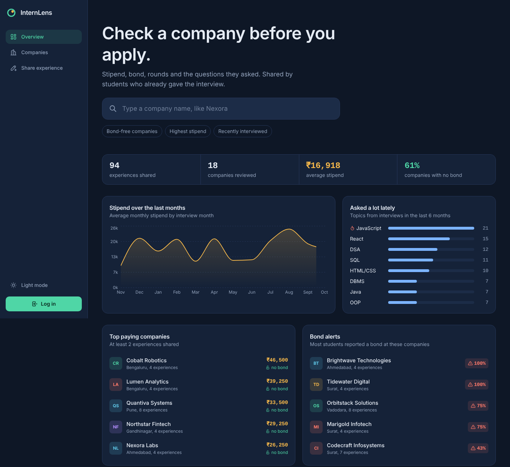
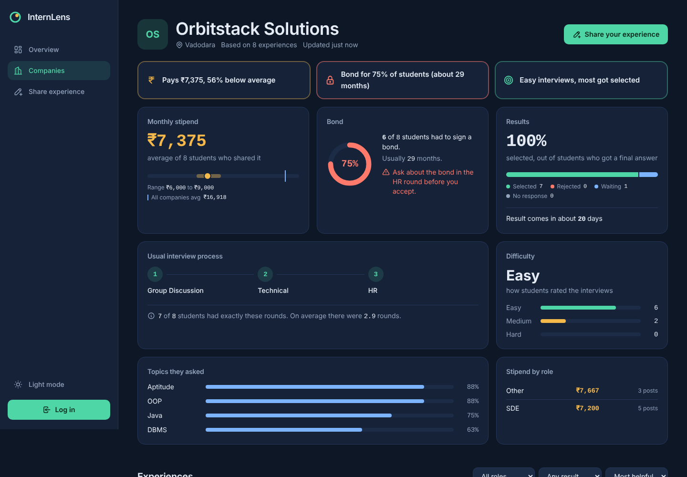
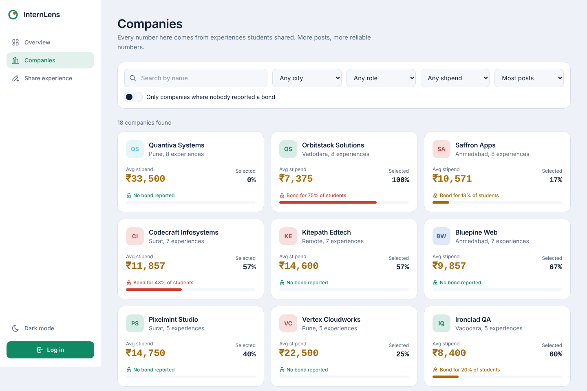

# InternLens

Check a company before you apply for an internship.

Students share their interview experience: rounds, questions, stipend, bond and result. InternLens turns those posts into a **report card for every company**, so the next student knows what to expect, and whether the offer comes with a bond, before saying yes.



## Why I built this

When we started looking for internships, most offers we saw on campus had a low stipend and a 1 to 2 year bond, and nobody tells you that until the offer letter. Interview experiences are scattered across WhatsApp groups and random posts. I wanted one place where you search a company and see the real numbers.

## Features

- **Company report card** built from approved experiences:
  - average stipend, range, and comparison with the average of all companies
  - bond alert: what percent of students reported a bond, and for how many months
  - selection rate and how many days the result takes
  - the most common order of rounds (for example Online Test, Technical, HR)
  - difficulty meter and the topics asked most
  - a warning when only a few students have shared, since the numbers can still change a lot
- **Share an experience** with a 4 step form: company and role, rounds, topics and tips, offer and result. Draft is kept in the browser if the page is refreshed. Can be posted anonymously.
- **Explore companies** with search, city, role, minimum stipend, "no bond only" filter and sorting. Filters are kept in the URL so a filtered list can be shared.
- **Overview dashboard**: stipend trend by month, topics asked lately, top paying companies, bond alerts.
- **Upvote** helpful experiences and **save** them for later.
- **Admin review queue**: new posts stay hidden until an admin approves them, so fake numbers don't end up in the report cards. Rejected posts show the reason to the author.
- Dark and light theme, works on mobile.



## Tech stack

| Part | Used |
| --- | --- |
| Frontend | React 19, Vite, React Router, TanStack Query, React Hook Form, Tailwind CSS v4, Recharts |
| Backend | Node.js, Express 5, Mongoose, Zod (validation) |
| Database | MongoDB |
| Auth | JWT in an httpOnly cookie, passwords hashed with bcrypt |
| Security | helmet, CORS with credentials, rate limit on login and register |

## How the report card is calculated

All the logic is in `server/src/modules/companies/reportCard.js`. These are plain functions (experiences in, numbers out), so they don't depend on Express or the database.

- **Average stipend** ignores posts where the stipend was not shared. "Unpaid" counts as 0.
- **Bond level**: `none` when nobody reported a bond, `common` when 40% or more did, otherwise `some`.
- **Selection rate** = selected / (selected + rejected). People still waiting are not counted, otherwise the rate would look worse than it is.
- **Usual rounds**: the most common exact order of rounds. If two orders are equally common, the one seen most recently wins.
- **Confidence**: fewer than 3 posts is low, 3 to 7 is medium, 8 or more is high.

The company list and the overview use MongoDB aggregation (`$group` with `$avg`, `$sum` and `$cond`) to calculate numbers for all companies in one query.

## Database design

- **User**: name, email, password (hashed, `select: false`), college, role (`member` or `admin`), savedExperiences
- **Company**: name, slug (unique), city, createdBy
- **Experience**: company, author, anonymous, role title and type, location, work mode, source, interview month, rounds (embedded array of type + details), topics, difficulty, tips, stipend, hasBond, bondMonths, outcome, daysToResult, upvotes, upvoteCount, status (`pending`, `approved`, `rejected`), reviewNote

Some decisions:

- Rounds are **embedded** in the experience, because they are always read together and never on their own.
- `upvoteCount` is stored next to the `upvotes` array, so sorting by "most helpful" can use an index.
- Upvote is a toggle done with two **conditional updates** (`$ne` then `$pull`), so clicking twice quickly can't make the count wrong.
- A new company is created with an **upsert on the slug**, so "Infosys" and "infosys " end up as the same company, even if two people add it at the same time.
- Editing an approved post sends it back to review.

## API

| Method | Route | Who | What |
| --- | --- | --- | --- |
| POST | `/api/auth/register` | anyone | create account, sets cookie |
| POST | `/api/auth/login` | anyone | log in, sets cookie |
| POST | `/api/auth/logout` | anyone | clears cookie |
| GET | `/api/auth/me` | anyone | logged in user or `null` |
| GET | `/api/meta` | anyone | dropdown values (roles, rounds, topics...) |
| GET | `/api/companies` | anyone | company list with stats and filters |
| GET | `/api/companies/search?q=` | anyone | autocomplete |
| GET | `/api/companies/cities` | anyone | cities for the filter |
| GET | `/api/companies/:slug` | anyone | company + report card |
| GET | `/api/experiences` | anyone | approved experiences, filter + paginate |
| GET | `/api/experiences/:id` | anyone | one experience (pending ones only for author or admin) |
| GET | `/api/experiences/mine` | member | my posts with status |
| POST | `/api/experiences` | member | share an experience |
| PUT | `/api/experiences/:id` | author, admin | edit |
| DELETE | `/api/experiences/:id` | author, admin | delete |
| POST | `/api/experiences/:id/upvote` | member | toggle upvote |
| GET | `/api/users/me/saved` | member | saved experiences |
| POST | `/api/users/me/saved/:id` | member | toggle save |
| GET | `/api/admin/experiences?status=` | admin | review queue |
| PATCH | `/api/admin/experiences/:id` | admin | approve or reject with a reason |
| GET | `/api/insights/overview` | anyone | numbers for the overview page |

## Project structure

The backend is organized **by feature**: everything for one feature (model, validation, controller, routes) sits in one folder.

```
internlens/
├── server/
│   └── src/
│       ├── config/          env, db connection, fixed lists (roles, topics...)
│       ├── middleware/      auth (cookie JWT), zod validation, errors
│       ├── modules/
│       │   ├── auth/
│       │   ├── companies/   includes reportCard.js
│       │   ├── experiences/
│       │   ├── users/
│       │   ├── admin/
│       │   └── insights/
│       ├── utils/
│       └── scripts/seed.js  demo data
└── client/
    └── src/
        ├── lib/             fetch wrapper, formatters, query client
        ├── hooks/           auth, theme, debounce, meta
        ├── components/      layout and small UI pieces
        ├── features/        companies, experiences, share form, auth, admin
        └── pages/
```

## Run it on your computer

You need **Node.js 20 or newer** and **MongoDB** (local MongoDB Community Server, or a free MongoDB Atlas cluster).

**1. Backend** (first terminal)

```bash
cd server
npm install
cp .env.example .env      # on Windows: copy .env.example .env
```

Open `server/.env` and set `JWT_SECRET` to any long random text. If you use Atlas, paste your connection string in `MONGO_URI`.

```bash
npm run seed              # adds demo companies and experiences
npm run dev               # API on http://localhost:5000
```

**2. Frontend** (second terminal)

```bash
cd client
npm install
npm run dev               # open http://localhost:5173
```

Demo logins after seeding:

| Role | Email | Password |
| --- | --- | --- |
| Admin | admin@internlens.dev | Admin@1234 |
| Student | demo@internlens.dev | Demo@1234 |

All companies in the demo data are made up, so the numbers can't be mistaken for real information about real companies.

## Deploy

- **Database**: MongoDB Atlas free cluster. Allow access from anywhere (0.0.0.0/0) for Render.
- **Backend on Render**: new Web Service, root directory `server`, build `npm install`, start `npm start`. Environment: `MONGO_URI`, `JWT_SECRET`, `NODE_ENV=production`, `CLIENT_ORIGIN=https://your-app.vercel.app`.
- **Frontend on Vercel**: root directory `client`, framework Vite. Environment: `VITE_API_URL=https://your-api.onrender.com`. `vercel.json` sends every route to `index.html` so page refresh works.

In production the cookie is set with `sameSite: "none"` and `secure: true`, because the frontend and backend are on different domains.

## What I would add next

- Match the same topic written in different ways ("DSA" vs "Data Structures")
- Email the author when a post is approved or rejected
- Report button on experiences
- Compare two companies side by side


